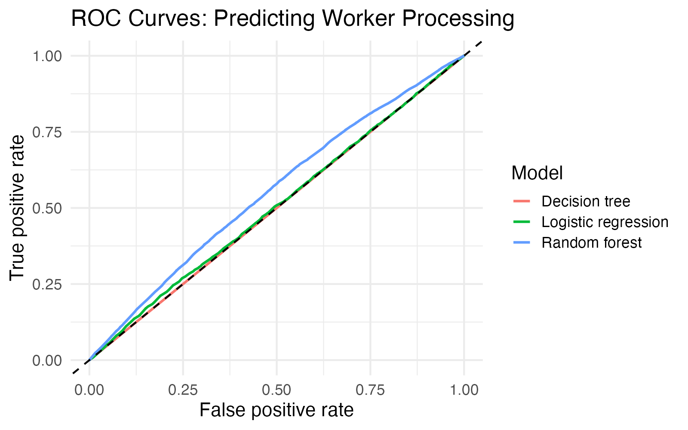

## What I was trying to find out

For my group's Hennepin County project, we look at over 240,000 applications and ask what leads a worker to process one by hand. I wanted to know whether basic information about an application could predict it. I tried three machine learning models, using each application's age, application method (online or paper), and race to predict whether a worker processed it.

## The chart

## How to read it

- **Each line is one model:** logistic regression, a decision tree, and a random forest.
- **The dashed diagonal line is random guessing.** A model on that line is no better than a coin flip.
- **A curve that bends toward the top-left corner is a good model.** The closer it gets, the better it separates applications a worker processed from the ones they didn't.
- **AUC is the area under a curve.** 0.5 means guessing and 1.0 means perfect.
- **The curves use the testing data**, which is 25% of the applications, set aside and never used to train the models. I split the data so that the share of worker-processed applications (about 18%) is the same in the training and testing sets.

## What I noticed

All three models are close to guessing:

| Model | AUC |
|---|---|
| Logistic regression | 0.507 |
| Decision tree | 0.500 |
| Random forest | 0.554 |

The random forest did best, but it's still weak. This matches what I found earlier in the project: online and paper applications are processed by a worker at nearly the same rate (18.5% vs. 17.8%). Age, application method, and race don't explain which applications get worker review.

## Why this still helps the project

A weak result is useful. It tells my group to stop looking at these basic fields and to look at other columns, such as the application status, to explain what sends an application to a worker.

## A note on the data

The Hennepin County application data is private, so this post shows only the model results and not the underlying data.

## (20 points) Code of Ethics for Data Visualization Portfolio Entry:

I'm interested in understanding your process for completing all the questions in this assignment. Please tell me about the tools and resources—including any use of AI—that helped you with your work. Please remember to follow the outlined Code of Ethics. Because our understanding of how to work with AI tools is emerging, please err on the side of including too much detail rather than too little.

AI was helpful to me in structuring this post especially since initially everything was all over the place. I was also confused on how we were suppose to reference the plot without the code, AI was very useful in helping me figure that out.

